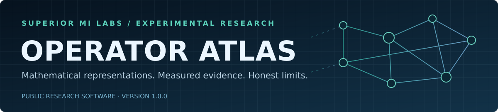
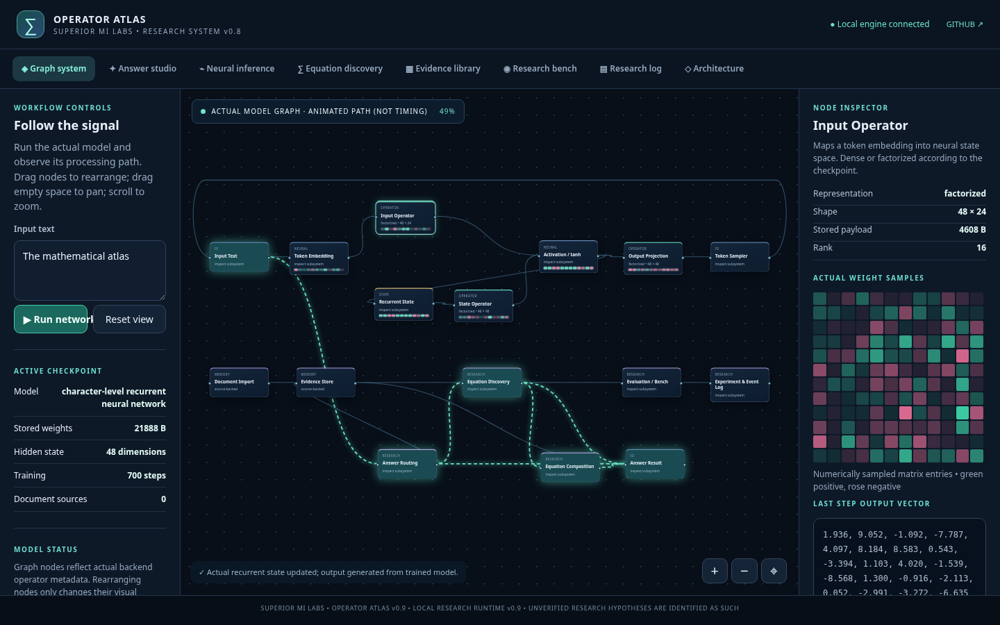
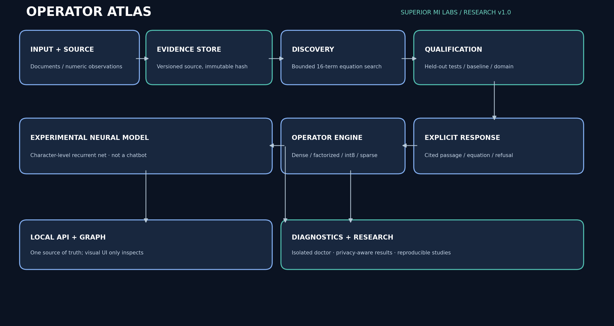
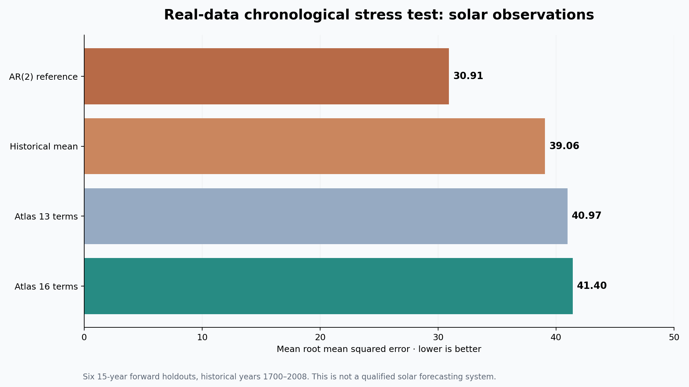
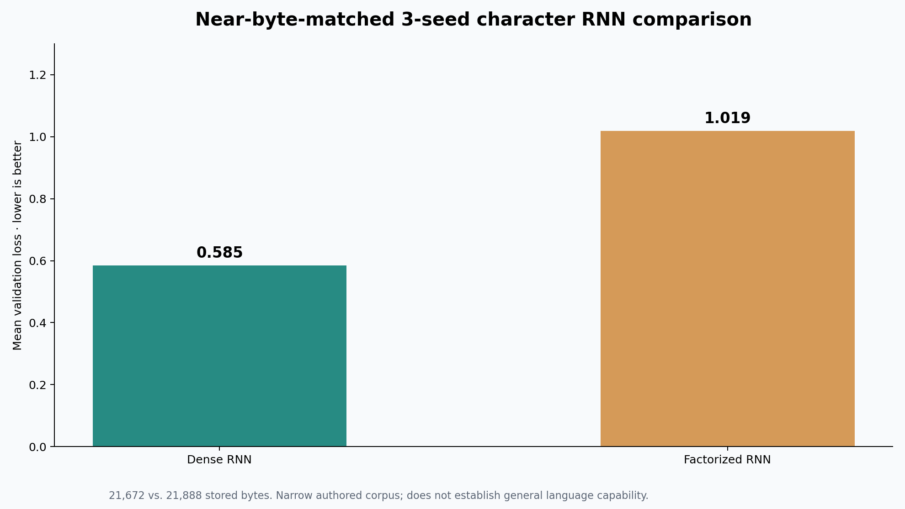

<div align="center">



# Operator Atlas

**A research workbench for mathematical representations, explicit evidence, and falsifiable experiments**

**Superior MI Labs · Public research release 1.0.0 · 20 October 2026**

[Read the whitepaper](docs/WHITEPAPER_V1.md) · [PDF](docs/Operator_Atlas_Whitepaper_v1.pdf) · [Reproduce the experiments](docs/REPRODUCIBILITY.md) · [Research decision](docs/RESEARCH_DECISION.md) · [Start the application](#install-and-run)

</div>

> **Status: experimental research software, not a general-purpose AI.** Operator Atlas can fit bounded equations, execute and inspect alternative mathematical operators, compose validated calculations, and retrieve passages from imported documents. Its tiny native language model **frequently generates gibberish**. Some of our most important experiments produced **negative results**. We publish those explicitly.



## The question that started it

Could some of the computation and information currently stored as large tables of learned weights be represented more efficiently by **mathematical relationships**—functions, factorized transformations, coordinate systems, and sparse exceptions? Could a system identify which representation to use, instead of assuming every problem needs the same one?

We began with this broad hypothesis, but deliberately separated it into testable problems. A compact formula may describe a structured signal beautifully while failing completely on unstructured information. Conversely, a standard dense or autoregressive model may be the right representation. **The research objective is not to make our preferred mechanism win; it is to learn where it works and where it does not.**

## What ships in the repository

| Subsystem | What it actually does | What it does **not** do |
|---|---|---|
| Mathematical operator substrate | Executes dense, int8, factorized, and sparse-corrected linear operations with one interface | Automatically invent a universal compressed weight representation |
| Equation discovery | Fits coefficients and selects terms from a **bounded grammar** on numerical observations; evaluates held-out inputs | Discover arbitrary laws of physics or guarantee extrapolation |
| Equation composition | Connects qualified equations and preserves input-range/source traces | Verify physical units or propagate calibrated uncertainty |
| Evidence library | Ingests text/CSV and supported files into local SQLite with content identities, and retrieves conservative cited excerpts | Retrain the neural network when you upload a document |
| Neural research model | Trains or executes small character-level recurrent networks with different operator structures | Serve as a reliable chatbot or a modern LLM |
| Node-graph workstation | Inspects genuine backend nodes, state and calculated results through a local browser | Act as a fully editable computation/compiler graph |
| Research / diagnostic pipeline | Runs local tests, controlled fixtures, benchmark probes, and sanitized diagnostics | Prove broad scientific validity from green tests |

**Separation of concerns:** a single Python engine owns the numerical computation and evidence state; the browser is a client, not a competing simulation.



## Findings — including the ones that did not support our hypothesis

The table below separates controlled positive results from unfavorable comparisons. Different rows describe different experiments and must **not** be aggregated into a single performance score.

| Question / experiment | Measurement | What we learned |
|---|---|---|
| Synthetic logarithmic relationship, 13-term grammar → 16-term grammar | Mean unseen-point RMSE **0.20458 → 0.001012**, five seeded runs | The candidate vocabulary matters. The dataset was constructed around the available form; not evidence of universal discovery. |
| Synthetic interaction signal, 8-term → 13-term grammar | Mean held-out RMSE **0.08794 → 0.00168**, five seeds | An appropriate cross-term materially helped on a designed task. |
| Near-byte-matched single-layer character RNNs | Dense loss **0.58505** vs factorized loss **1.01851**; three seeds | Dense was clearly better on this small repetitive text corpus. |
| Variance-matched two-layer RNNs | Dense loss **0.30033** vs factorized loss **0.36647**; three seeds | Initialization explains part of the original gap but does not reverse the outcome. |
| Local int8 operator probe | ~**55% less** stored parameter bytes, but **slower** CPU execution on the tested workload | Storage savings do not automatically translate into latency savings. |
| Fictional document questions | **18/18** source-sentence matches and **10/10** correct refusals | Carefully designed lexical fixtures can pass; independent semantic comprehension is unproven. |
| Real annual sunspots, six chronological forecast windows | Atlas 16-term **41.40** vs AR(2) **30.91** RMSE | The equation learner **lost** to a simple time-series model on unfamiliar dynamics. |



The astronomical study uses 309 annual sunspot observations (1700–2008), with six fixed forward-in-time 15-year evaluation windows. It was designed as a **stress test of an out-of-domain representation**, not as a claim that Atlas is a forecasting product. Those six windows are correlated and are not six independent statistical experiments. We include the original dataset provenance, scripts, holdout definitions, and raw results.



These results do **not** establish the superiority of mathematical weight-field models over dense or quantized neural models. They suggest more narrowly that **representation and problem structure must be matched**, and even then the full memory–latency–accuracy trade-off must be measured.

Read the [experiment catalog](docs/EXPERIMENT_CATALOG.md), [research decision](docs/RESEARCH_DECISION.md), and [whitepaper](docs/WHITEPAPER_V1.md) for assumptions, confounders, and unresolved questions.

## A five-minute walkthrough

**1. Run the built-in reproducible demonstration.**

```bash
./launch.sh demonstrate
```

It uses fictional notebooks and synthetic calibration CSVs. Before importing the fictional notebook, a relevant question is unsupported; after import, the system can return a cited sentence. This is **evidence retrieval**, not neural fine-tuning. The equations are fitted by a predefined grammar, not synthesized without constraints.

**2. Test the source-backed question flow.**

```bash
./launch.sh respond 'What calibration interval does the Lazuli spectrometer record?'
./launch.sh import-file examples/fixtures/evidence_qa.md
./launch.sh respond 'What calibration interval does the Lazuli spectrometer record?'
```

Expected: an initial refusal; after importing, a cited fictional sentence specifying **28 minutes**. Use a fresh evidence store, or the first query may already have an answer.

**3. Challenge the mathematical discovery system on real data.**

```bash
./launch.sh study-real
```

This reports future-horizon error against historical mean, last-value, and AR(2) controls. Atlas does *not* win that comparison.

**4. Inspect the experimental language route without disguising it.**

```bash
./launch.sh respond --mode experimental 'The mathematical atlas'
```

Expect imperfect, often nonsensical text; temperature changes sampling variety, not knowledge.

**5. Capture a diagnostic package for reproducibility or bug reports.**

```bash
./launch.sh doctor
```

The resulting ZIP is created under `~/Downloads` and contains bounded fixture results, test summaries, and sanitized environment diagnostics. It excludes imported document contents and the personal evidence database; **review reports before uploading them anywhere**.

## Install and run

Tested primarily as local Linux/Python research software. Python **3.10+**, a browser, NumPy, and pytest are required. PyTorch is optional for new training experiments; CPU-backed inference uses NumPy. A detected GPU is **not** the same as a working GPU numerical backend.

```bash
# Clone after the complete source files appear in this repository.
git clone https://github.com/Superior-MI-Labs/Operator-Atlas-Experimental.git
cd Operator-Atlas-Experimental
python3 -m venv .venv
.venv/bin/python -m pip install -r requirements.txt
./launch.sh doctor
./launch.sh
```

Open **http://127.0.0.1:8765**. Stop an earlier Atlas server if it already occupies that port. If executable mode was lost, `bash launch.sh doctor` and `bash launch.sh` are equivalent. The HTTP endpoint is **localhost research software**, not a secured public server; do not expose it to an untrusted network.

For a training environment, install `requirements-train.txt` inside the venv. Default checkpoints and deliberately small example datasets ship in `models/` and `data/`.

## Research map: where to look first

| Path | Audience / content |
|---|---|
| [`docs/WHITEPAPER_V1.md`](docs/WHITEPAPER_V1.md) and [`PDF`](docs/Operator_Atlas_Whitepaper_v1.pdf) | Formal research questions, architecture, experimental data, negative results and literature |
| [`docs/EXPERIMENT_CATALOG.md`](docs/EXPERIMENT_CATALOG.md) | Measurement definitions, baselines, limitations and file-level evidence pointers |
| [`docs/REPRODUCIBILITY.md`](docs/REPRODUCIBILITY.md) | Exact commands, isolation rules, interpretation and report collection |
| [`docs/RESEARCH_DECISION.md`](docs/RESEARCH_DECISION.md) | Development timeline, dead ends, likely use cases, and explicit continuation criteria |
| [`docs/ARCHITECTURE.md`](docs/ARCHITECTURE.md) and [`docs/INTERFACES.md`](docs/INTERFACES.md) | Numerical/HTTP/storage contracts and state owners |
| [`results/`](results/) | Versioned machine-readable experiments, both favorable and unfavorable |
| [`examples/fixtures/`](examples/fixtures/) | Fictional documents, equation-fitting CSVs and negative controls |
| [`tests/`](tests/) | Program invariants, numerical parity, retrieval and API tests |
| [`models/`](models/) | Small starter and baseline neural checkpoints, not production models |
| [`atlas/`](atlas/), [`web/`](web/) | Canonical engine and separate view layer |
| [`AGENTS.md`](AGENTS.md) | Architecture and evidence-navigation guidance for developers and coding agents |
| [`docs/LICENSING.md`](docs/LICENSING.md) | Current licensing status and third-party data disclosures |

## What should a researcher conclude?

**Continue** investigations into structured numerical representations, adaptive representation selection, bounded symbolic regression, domain refusal, provenance, scientific-unit checks, and hardware-aware evaluation. These are legitimate, testable software-research questions.

**Do not scale** the conjecture that arbitrary model weights or factual knowledge can be recovered from tiny formulas without substantial new evidence. On the included small language trials, dense controls were better; on the sunspot test, a simple autoregressive control was better. These unfavorable outcomes are first-class results, not embarrassing details to conceal.

This release is a **research checkpoint**. We welcome critical reproduction, counterexamples, issue reports, and independent datasets with clear reuse terms. See [Contributing](CONTRIBUTING.md) and [Security](SECURITY.md). Please do not describe the project as a peer-reviewed breakthrough or a general-purpose AI.

## Credit, links, and licensing

Developed by **Superior MI Labs**, a small independent R&D initiative in Upper Michigan. [Superior MI Labs organization](https://github.com/Superior-MI-Labs) · [Earlier mathematical-field interactive exhibit](https://huggingface.co/spaces/Superior-Mind-Labs/mathematical-weight-fields).

**License decision pending:** Public access to a source repository does **not** itself grant permission to reuse, redistribute or incorporate the code. See [`docs/LICENSING.md`](docs/LICENSING.md). An explicit software license, separate trained-model terms if needed, and third-party rights review should be agreed before encouraging reuse as open-source software.