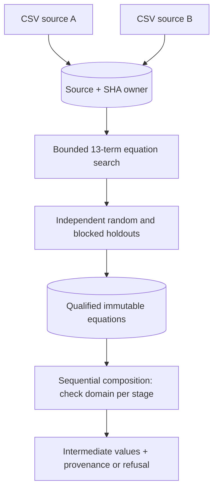
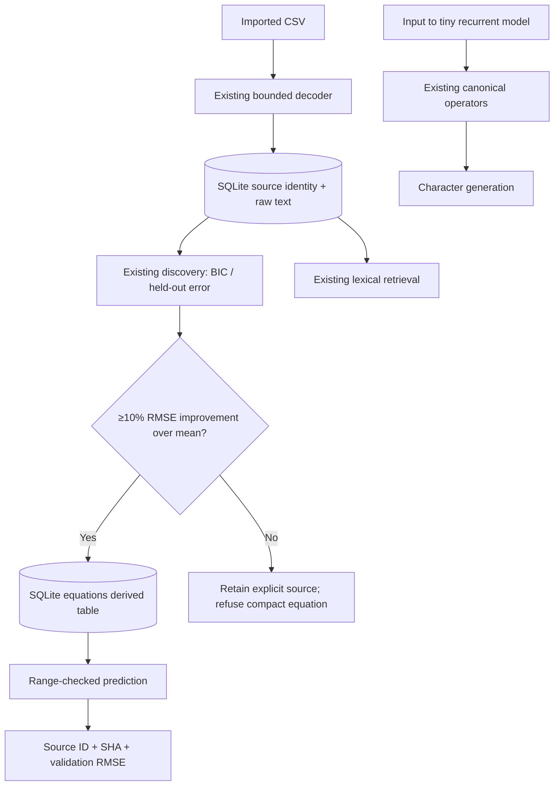
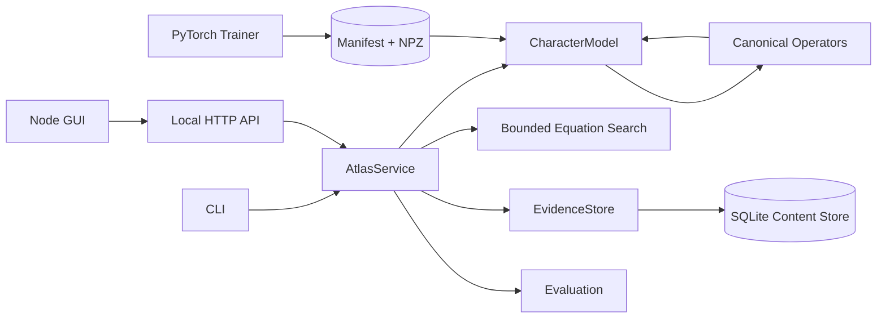

# v0.8 mathematical composition amendment

Source of truth remains `atlas/memory.py` for durable source/equation records,
`atlas/discovery.py` for equation fitting, and `atlas/api.py` for actions.
A composition is an ephemeral evaluation through the source owner; no alternate
materialized representation, model runtime or secondary writer is introduced.
The additional `composition` graph node reflects this actual service action.



See [Equation Composition Contract](EQUATION_COMPOSITION_V08.md).

---

# Operator Atlas — Architecture and Implementation Contract

**Design authority:** Superior MI Labs · schema v0.2 · research system, not production intelligence.

## v0.6 scientific extension — provenance-first functional learning

The original five owners remain authoritative: `operators.py` for numerical
execution, `model.py` for neural inference, `memory.py` for durable evidence,
`discovery.py` for fitting equations, and `api.py` for typed service actions.
The GUI is a replaceable client.

**Why evidence-derived equations, not automatic model weight mutation?** Two
approaches were considered: (A) fine-tune the tiny RNN after any file import,
and (B) retain imported source facts and derive small qualified mathematical
artifacts from numerical observations. (A) would create uninterpretable
interference/forgetting and require a licensed language dataset and validation
process, and would confuse retrieval with learning. (B) uses existing source
provenance and bounded equation fitting with measurable holdout errors. **(B)
was implemented first.** Model-weight retraining remains an explicitly separate
research task.



- **No additional data owner:** `equations` is a derived, immutable SQLite table
  keyed by `(source_id,x_column,y_column,method_version)`. A source still owns
  ground truth; equations own only fitted approximations. Idempotent insert
  protects repeated requests and concurrent sessions.
- **Bounded decoding:** 12–10,000 finite, unique-coordinate observations per
  numerical CSV; source ingestion already has file size and text limits.
- **Qualification:** `atlas/discovery.py` fits up to three basis terms chosen
  by training BIC, and assesses validation RMSE. Persist only if at least 10%
  better than the mean-only baseline. This is not calibration or a proof of
  physical validity; error estimates may fail under distribution shift.
- **Inference:** `predict_equation` refuses coordinates outside observed
  bounds and returns evidence hash, estimated numeric value and fit error.
- **Privacy:** doctor imports only distributed synthetic fixtures in an
  isolated workspace. No user source text is copied to diagnostic archives.
- **Canonical control surfaces:** HTTP `learn_equation`, `equations`,
  `predict_equation`, and matching thin CLI helpers invoke one AtlasService
  pathway. Browser never fits functions.
- **Graph:** the evidence→equation edge is a *declared capability dataflow*,
  not an always active recurrent neural inference path.

### Use-case boundary

Scientific and industrial tables with regular numerical structure are plausible
sources for compact estimators. Historical facts, book passages and arbitrary
identifiers remain explicit source records. Security-critical, medical and
safety-critical decisions cannot rely on this uncalibrated research fitter.

---

## Scope, invariants and state owners

- **One operator implementation:** `atlas/operators.py` defines dense, factorized, factorized+sparse, and int8 kernels. Other modules request these operators; no GUI numerics or duplicate hidden matrix definitions.
- **One checkpoint owner:** `models/<checkpoint>/manifest.json` defines operator types and shapes; `weights.npz` stores arrays. Runtime inference loads from this artifact. The training code exports and parity-checks this representation. Default training writes a candidate artifact; serving another checkpoint requires explicit `--model` selection.
- **One evidence owner:** SQLite `data/evidence.sqlite3` stores immutable source text revisions and retrievable chunks. Model parameters do not own document provenance.
- **One computation authority:** `atlas/model.py` produces real recurrent state updates and output scores. The graph is an *inspector* of this execution, not a second execution pipeline.
- **One API:** CLI and local HTTP endpoints use the same model/evidence/equation/benchmark services. Browsers never compute candidate operator outputs themselves.
- **No hidden authority:** The graph layout is editable locally but cannot mutate model parameters or declare a training run qualified.

## Dataflow



## Canonical layer equation

For the shipped one-layer Elman RNN, for each character token t:

\[
e_t = E[x_t],\qquad
h_t=\tanh(W_{in}e_t+W_{rec}h_{t-1}+b),\qquad
z_t=W_{out}h_t+b_{out}.
\]

Then softmax(z/T) is sampled with a supplied random seed. With `factorized` representations each W is stored as A(out,r) and B(r,in) and `apply` computes `(x @ B.T) @ A.T` without constructing W. The trained model is **not** the multi-layer neural model described in earlier research aspirations; v0.2 deliberately tests the shared operator contract on one recurrent layer first. Multi-layer interfaces can be introduced without a parallel runtime.

### Operator contract

- Logical shape `(output_dimension, input_dimension)`.
- `apply(float32 x)` supports vectors and batches; last dimension is input.
- `payload_bytes()` accounts for actual NumPy payload arrays including sparse coordinate arrays and quantization scale.
- `dense_equivalent()` only for diagnostic comparisons and sampled heatmaps, **not** on the hot path for factorized inference.
- Serialized arrays must match declared shapes and named keys; missing arrays and invalid sparse coordinates reject.
- `factorized_sparse` stores actual nonzero correction rows, columns and values, not a masked full residual. It uses alternating rank/sparse fitting; quality is not guaranteed.
- `int8` is symmetric per-tensor quantization. This is a valid baseline but not competitive with optimized production quantizers.

## Automatic representation selection (experimental)

`atlas/selection.py` enumerates dense, int8, ranks and sparse corrections. Each candidate is fit to an existing matrix, checked on specified validation activations, and the smallest passing payload is selected. A separate shifted-input set can be reported **but cannot influence selection**. It is neither adaptive neural training nor unrestricted mathematical discovery.

`atlas/discovery.py` searches subsets of eight predefined functions (up to three terms), fits least-squares coefficients, uses BIC for model selection and reports validation RMSE against a mean-only predictor. Its support is bounded; it cannot discover arbitrary mathematical laws.

## Training and export

`atlas/train.py` uses PyTorch on a versioned training corpus to optimize embeddings, operator factors/weights, bias and output head against character next-token cross entropy. It exports a NumPy-ready checkpoint with vocabulary and SHA-256 of the training corpus. It then compares final logits on a known sequence through PyTorch and NumPy, rejecting divergence greater than `1e-4`.

Train/eval split is positional 88/12 and the corpus includes repeated templated sentences. It is suitable for a codepath demonstration **not** for claims of generalization or language competence. The model does not read a new book and update weights. Library ingestion stores immutable evidence only.

## Hardware and security boundaries

The GUI and numerical kernels are independent. NumPy currently executes CPU math. Optional PyTorch is used for offline training. CUDA training, GPU operator compilation and hardware dispatch are **not yet implemented**. Timing reported by the benchmark is local CPU time, not an inference tokens/s claim.

The API binds only to loopback. There is no authentication or multi-tenant isolation; do **not** expose it through port forwarding or a public reverse proxy. API text and arrays have bounded request sizes. Source documents are stored locally without encryption or a rights-management workflow.

## File index (single responsibility per file)

| Path | Ownership |
|---|---|
| `atlas/operators.py` | Numerical operator semantics and math kernels |
| `atlas/selection.py` | Validation-gated representation candidates |
| `atlas/model.py` | Autoregressive inference and numerical traces |
| `atlas/train.py` | Gradient training and canonical checkpoint export |
| `atlas/discovery.py` | Bounded equation grammar and coefficients |
| `atlas/memory.py` | SQLite immutable evidence and retrieval |
| `atlas/evaluation.py` | Real numerical experiments and local benchmark |
| `atlas/graph.py` | Static logical graph metadata / positions |
| `atlas/api.py` | Local HTTP transport and services |
| `atlas/cli.py` | CLI routing; no duplicated logic |
| `web/index.html` | Interface structure |
| `web/app.js` | UI controls, graph pan/zoom and API actions |
| `web/style.css` | UI presentation only |
| `data/corpus.txt` | Authored demo training data |
| `models/starter/` | Exported factorized checkpoint |
| `models/dense-control/` | Exported conventional control |
| `results/` | Run artifacts and measured outcomes |
| `tests/` | Executable contract and integration checks |
| `launch.sh` | Portable Linux entrypoint |

## Scientific correctness limits

Satisfying operator parity doesn't mean learned language quality; validation loss doesn't prove open-domain generalization; sparse corrections can carry heavy index/compute overhead; equations can extrapolate incorrectly; compression on familiar activations can fail abruptly on shifted inputs. See RESEARCH.md.

---

## v0.3 additions — workflow, observability and actual-model quality probes

The original v0.2 operator, model, checkpoint and evidence authorities are **preserved**, not cloned. `atlas/importers.py` is only a bounded format decoder feeding `EvidenceStore.ingest`. Source metadata (`source_name`, `media_type`, original binary SHA-256) is stored in the existing SQLite `sources` relation through an additive schema migration. File-byte hash and extracted-text hash are distinct, intentional provenance fields. Browser uploads use local JSON base64; CLI imports read local files directly. No remote URLs are fetched, no source is executed, and no weights are implicitly updated.

`atlas/diagnostics.py` provides a single append-only local JSONL event stream. Event schemas deliberately permit only non-content operational metadata (`action`, elapsed time, success/failure, checkpoint, source ID, candidate count, etc.). No prompts, paths or original document text are included. Experiment results are written atomically to unique IDs under `results/runs/`. The log is a **diagnostic** mechanism, not a secure audit trail or long-term rotating log platform. `./launch.sh report` exports a bounded sanitized ZIP for sharing without the source database or source text.

`atlas/probe.py` performs held-out **teacher-forced next-character loss** measurement using the real `CharacterModel.step` and canonical `Operator.apply` methods. The last 12% of the authored corpus was excluded from v0.2 training; the probe divides it into validation and a separate reporting-only test partition. A greedy search tries dense, int8 and truncated-rank replacements for each of the three matrices, subject to a maximum *total validation* cross-entropy increase. It counts actual NumPy payload bytes and reports a separate shuffled-text negative control. Selected results may be exported as an immutable checkpoint via the CLI; there is no automatic promotion. Repetitive source templates imply probable semantic overlap across partitions.

### Graph contracts

The GUI visualizes and inspects the authoritative graph metadata and real checkpoint activations. Newly depicted Document Import and Diagnostics nodes represent separate **data ingestion / observation** surfaces, not components of the recurrent hot path. Only actual neural dataflow edges animate on generation. The GUI controls API requests; it cannot own or mutate weights or edit executable topology.

### Local security and privacy

The HTTP service remains loopback-only with Origin-checking for POSTs, size bounds for action requests, no external networking, and no authentication. Imported data may be sensitive: users must protect the `data/` directory and not expose the port publicly. PDF parsing is optional and bounded by input bytes and page count; scanned PDFs are unsupported. A proper public multi-user service would need isolation, authentication, quotas, upload sandboxing, stronger content security and operational controls.


## v0.4 — Layered neural state and diagnostic qualification

The original one-layer checkpoint (`manifest.schema=1`, absent `layers`) remains equivalent to `layers=1`. New checkpoints declare `layers` (1–4 trained; reader allows up to 8) and canonical operator keys `input`, `recurrent`, `input_1`, `recurrent_1`, and so on, plus shared `head`. Runtime state is a concatenation of independent per-layer recurrent vectors. The first layer receives embeddings; each later layer receives the preceding layer's current activation. No second numerical executor is introduced.

For layer index j at time t:

```text
z[0,t] = embedding(token[t])
h[j,t] = tanh(A_input[j](z[j,t]) + A_recurrent[j](h[j,t-1]) + bias[j])
z[j+1,t] = h[j,t]
logits[t] = A_head(h[last,t]) + head_bias
```

Currently `bias[0]` is trainable and deeper recurrent layers have zero explicit bias. Learned input/recurrent operators share the original `Operator.apply` contract. Tensor shapes and checkpoint references are validated by `CharacterModel`. The v0.4 initialization for a factor pair (A,B) scales each factor to approximate the effective FP32 dense matrix standard deviation (0.07): `sigma = sqrt(0.07) / rank**0.25`. The checkpoint ID incorporates initialization version so changed training semantics cannot silently claim the prior artifact identity. Existing artifacts retain their original weights and IDs.

`atlas/graph.py` remains the sole visual graph descriptor. The API now calls `graph(service.model)` so a 2-layer model exposes 17 nodes and correct edges; legacy models expose 13. Browser nodes only read operator metadata and actual execution vectors. UI layout edits are not model edits.

### Diagnostics authority

`atlas/doctor.py` orchestrates qualification; it does **not** redefine numerical operations or report packaging. Active tests run in a disposable copy with a whitelist of shipped files, explicitly excluding user evidence DBs, source files, private logs and candidate checkpoints. It reuses canonical neural operators, model, equation discovery, SQLite evidence implementation, HTTP service and actual task-level probe. Existing `atlas/diagnostics.py` remains the sole event/report owner. Its `export_report` adds the optional `doctor.json` to existing output.

Release-file integrity uses `SHA256SUMS.json`; mutated release files cause a check failure without stopping the remaining tests. Optional package availability is reported rather than assumed. Crash or corrupted checkpoint during passive status acquisition must still allow an export with an error type. No public API is exposed for running arbitrary diagnostic code. The HTTP server refuses non-loopback binding.


## v0.5 — Runtime-aware representation policy

The only neural operator execution authority remains `atlas/operators.py`;
`atlas/probe.py` adds an optional **policy**, not a second codec or inference
engine. Candidate enumeration and validation loss are unchanged. `storage`
chooses the smallest validation-qualified plan. `latency_guarded` first makes
that choice, measures baseline and compact plan on **validation-only** inputs,
and applies the compact plan only when measured latency is within the allowed
regression. Otherwise it uses the unmodified original operators. Neither
selection criterion reads sealed test loss or timing. The UI is a thin form on
`AtlasService.process('probe', ...)`, also exposed through the CLI. Output
contains the rejected candidate's measurements and the actual applied plan.
There is no persistent global dynamic routing, no device-specific dispatch,
and no new model claims. This gate reduces exposure to a measured regression,
but cannot guarantee production latency under distribution shift.


## v0.7 typed response contract

`atlas.responder.respond()` is a small orchestration function **over existing
systems**, not a competing intelligence engine. The immutable evidence SQLite
store remains the source of truth for documents and persisted equations. The
NumPy `CharacterModel` remains the only neural inference implementation. The
HTTP API and CLI both dispatch through `AtlasService.process()`; the browser
only presents returned traces and never implements hidden retrieval or math.

`grounded`: parse a strict qualified-equation syntax; otherwise lexical passage
retrieval; otherwise abstain. Numeric candidates are never extrapolated beyond
the persisted observed range. Extracted text is labelled as a potentially
relevant passage, not a model-generated verified fact. `experimental` explicitly
invokes the original character checkpoint and labels its output ungrounded.

`atlas.language_eval` measures temperature-dependent lexical statistics and
held-out character cross-entropy. Statistics describe this decoder and cannot
be used as metrics of truth, fluency, generality or helpfulness. The decoder
still has not learned human-level language ability.

### Future v1 gates

1. Held-out natural text from a genuinely diverse, license-reviewed corpus;
   inspect qualitative generation blind to checkpoint choice.
2. Data-trained mathematical layers with cost- and capacity-matched controls;
   report failures and actual resident memory and CPU/GPU latency.
3. Evidence-grounded retrieval precision, contradiction and no-answer metrics
   on multiple documents; lexical overlap alone is not enough.
4. Document ingestion semantics: provenance, deduplication, revisions and
   training-data approval for parametric updates; never assume import=learning.
5. Optional trusted server deployment with authentication and resource bounds;
   keep local-by-default privacy and isolated test data.


## v0.9 — Coordinate-aware mathematical discovery and conservative evidence

The single equation learner `atlas.discovery` now has an affine polynomial coordinate `z=(x-center)/scale` when x magnitudes exceed 10. Periodic, logarithmic, square-root and reciprocal terms use raw positive x. `coordinate_center` and `coordinate_scale` travel with the fitted model; legacy v2 persisted equations omit them and retain raw-coordinate prediction semantics. The SQLite equations table remains the sole derived-equation authority. New fits have method version `coordinate-bic-v3`. The report displays the coordinate note so `(x)` isn't misread as raw when the fit uses z.

For source-backed responses, `EvidenceStore.answer_sentences` derives candidate sentences from the canonical immutable `sources.content` and requires conservative word coverage. It doesn't create a competing answer database or neural model. The responder selects and cites those results. It remains lexical and cannot verify whether a source is true. Both normal and experimental response routes remain distinguishable.

`tools/package.py` now controls the Unix archive mode explicitly rather than depending on source filesystem permissions.
